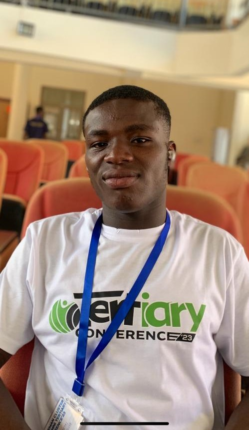

```{=html}
<script type="application/ld+json">{"@context": "https://schema.org", "@type": "ProfilePage", "url": "https://faboagye.github.io/", "mainEntity": {"@type": "Person", "name": "Fuseini Aboagye", "url": "https://faboagye.github.io/", "image": "https://faboagye.github.io/files/images/Fprofile.png", "jobTitle": "Teaching Assistant", "affiliation": {"@type": "CollegeOrUniversity", "name": "University of Ghana", "url": "https://www.ug.edu.gh/"}, "alumniOf": [{"@type": "CollegeOrUniversity", "name": "University of Ghana"}], "knowsAbout": ["Statistics", "Biostatistics", "Economics", "Longitudinal data analysis", "Survey methodology"], "sameAs": ["https://linkedin.com/in/fuseini-aboagye-8379aa237", "https://scholar.google.com/citations?user=2NIQbBwAAAAJ", "https://www.researchgate.net/profile/Fuseini-Aboagye", "https://github.com/faboagye"]}}</script>
<section class="wrap hero">
  <div class="hero-text">
    <p class="overline">Statistics and Economics · University of Ghana</p>
    <h1>Fuseini Aboagye</h1>
    <p class="lead">I am a Teaching Assistant in the <a href="https://www.ug.edu.gh/statistics/" target="_blank" rel="noopener">Department of Statistics and Actuarial Science</a> at the <a href="https://www.ug.edu.gh/" target="_blank" rel="noopener">University of Ghana</a>, where I earned a B.A. in Statistics and Economics with First Class Honours.</p>
    <p class="cta"><a class="btn" href="publications.html">Research</a> <a class="btn ghost" href="cv.html">CV</a></p>
    <p class="links"><a href="https://scholar.google.com/citations?user=2NIQbBwAAAAJ&amp;hl=en&amp;oi=ao" target="_blank" rel="noopener">Google Scholar</a> <a href="https://www.researchgate.net/profile/Fuseini-Aboagye" target="_blank" rel="noopener">ResearchGate</a> <a href="https://linkedin.com/in/fuseini-aboagye-8379aa237" target="_blank" rel="noopener">LinkedIn</a> <a href="https://github.com/faboagye" target="_blank" rel="noopener">GitHub</a> <a class="mail" data-u="aboagyefuseini" data-d="gmail.com" href="#">Email</a></p>
  </div>
  <figure class="portrait"><span class="portrait-crop"></span></figure>
</section>

<section class="wrap section" id="about">
  <div class="cols">
    <h2>About Me</h2>
    <div class="prose">
      <p>Thank you for visiting my website!</p>
      <p>I completed a double major in Economics and Statistics at the <a href="https://www.ug.edu.gh/" target="_blank" rel="noopener">University of Ghana</a> with First Class Honours (GPA 3.91/4.00), graduating in the top 1% of my class as Overall Best Student in both Statistics and Economics. My interests lie in statistical methodology and quantitative research, with applications in health, economics, and public policy.</p>
      <p>In statistics, my research examines structural brain changes associated with Alzheimer&rsquo;s disease using longitudinal MRI data and statistical learning. In economics, I studied the design and implementation of Multiple Indicator Cluster Surveys (MICS) and the role of census questionnaires in evidence-based policymaking. These experiences have deepened my interest in applying rigorous statistical methods to real-world problems through graduate study.</p>
    </div>
  </div>
</section>

<section class="wrap section" id="news">
  <div class="section-head"><h2>Recent News</h2><a class="more" href="Awards.html">All awards and honors</a></div>
  <ul class="news">
    <li><span class="news-date">November 2025</span><span>Completed my undergraduate thesis, <a href="files/Alzheimers_Research.pdf" target="_blank" rel="noopener">Statistical and Machine Learning Approaches to Exploring Brain Structural Changes in Alzheimer&rsquo;s Disease Progression</a>.</span></li>
    <li><span class="news-date">October 2025</span><span>Began serving as a Teaching Assistant in the Department of Statistics and Actuarial Science, University of Ghana.</span></li>
    <li><span class="news-date">September 2025</span><span>Selected as a mentee for <strong>StatFest 2025</strong>, American Statistical Association.</span></li>
    <li><span class="news-date">2025</span><span>Received the <strong>Best Teaching Assistant Award</strong>, Department of Statistics and Actuarial Science, University of Ghana.</span></li>
    <li><span class="news-date">2025</span><span>Received the <strong>Sadhu T. L. Vaswani / Indian Association of Ghana Endowment Fund Award</strong> as Overall Best Graduating Student in Economics.</span></li>
    <li><span class="news-date">2025</span><span>Graduated with First Class Honours in Statistics and Economics, University of Ghana.</span></li>
    <li class="news-extra"><span class="news-date">2025</span><span>Co-authored two preprints: <a href="https://arxiv.org/abs/2508.16018" target="_blank" rel="noopener">malaria trends in the Comoros Islands</a> and <a href="https://arxiv.org/abs/2508.15762" target="_blank" rel="noopener">Bayesian surveillance of cervical dystonia treatments</a>.</span></li>
    <li class="news-extra"><span class="news-date">2024</span><span>Named <strong>Overall Best Level 200 Student</strong> in both Economics and Statistics for the 2022/2023 academic year.</span></li>
    <li class="news-extra"><span class="news-date">June 2024</span><span>Led an <strong>Introduction to R</strong> workshop for undergraduates, Department of Statistics and Actuarial Science.</span></li>
    <li class="news-extra"><span class="news-date">October 2023</span><span>Led an <strong>Introduction to LaTeX</strong> session for undergraduates, Department of Statistics and Actuarial Science.</span></li>
    <li class="news-extra"><span class="news-date">2022</span><span>Received the <strong>Fondazione Edu Scholarship</strong>, University of Ghana Financial Aid Office.</span></li>
  </ul>
</section>

<section class="wrap section" id="journey">
  <div class="cols">
    <h2>My Academic Journey</h2>
    <div class="entries">
<article class="entry"><div class="entry-date">Oct 2025 – Present</div><div class="entry-body"><h4>Teaching Assistant</h4><p class="meta">Department of Statistics and Actuarial Science, University of Ghana</p></div></article>
<article class="entry"><div class="entry-date">Jan 2022 – Sept 2025</div><div class="entry-body"><h4>B.A. in Statistics &amp; Economics, First Class Honours</h4><p class="meta">University of Ghana, Legon</p></div></article>    </div>
  </div>
</section>

<section class="wrap section" id="beyond">
  <div class="cols">
    <h2>Beyond Research</h2>
    <div class="beyond">
      <div>
        <p>Outside of research and teaching, I give back through student leadership and mentorship. I chair the Academic and Scholarship Committee of Jubilee Hall, have served on the academic committee of the University of Ghana Actuarial and Statistics Society, and returned to Compassion International Ghana as a peer mentor for younger students.</p>
        <p><a href="leadership.html">Leadership and service</a></p>
      </div>
      <figure class="photo"><figcaption>2023 Tertiary Conference, Compassion International Ghana, Mfantseman Cluster: &ldquo;Meeting the Challenges of the Next Decade.&rdquo;</figcaption></figure>
    </div>
  </div>
</section>
```
