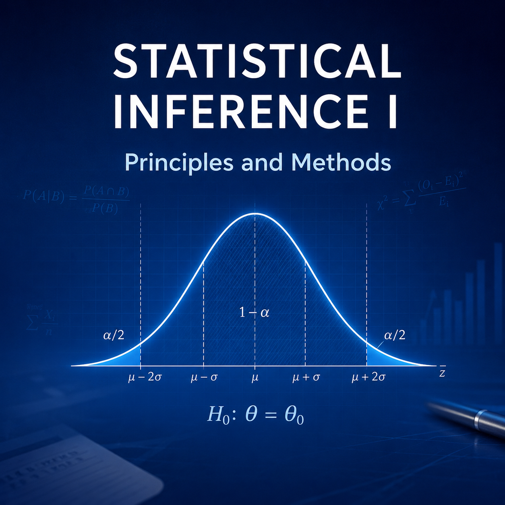
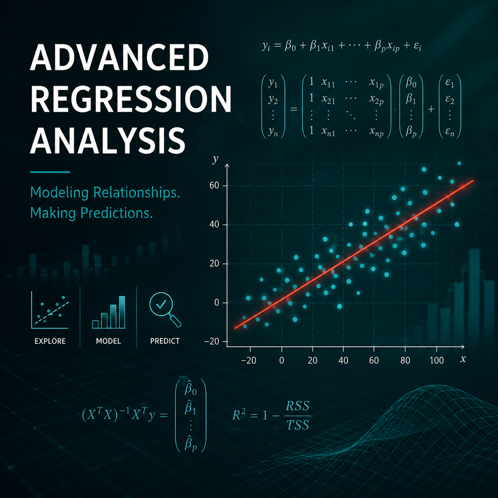
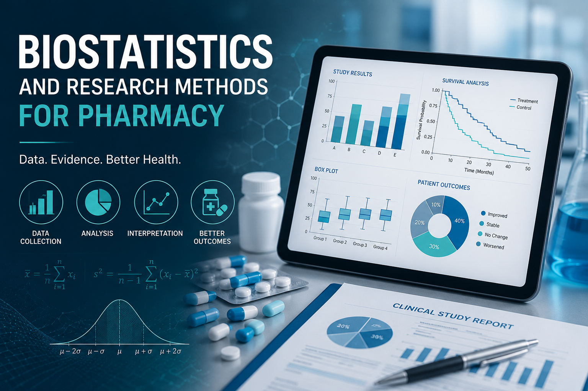
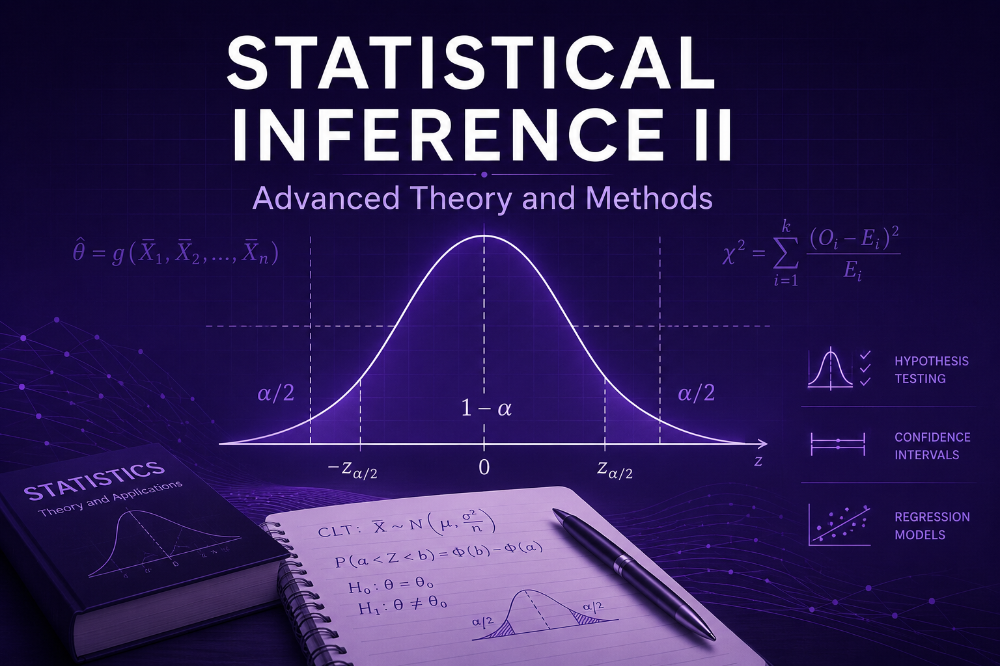
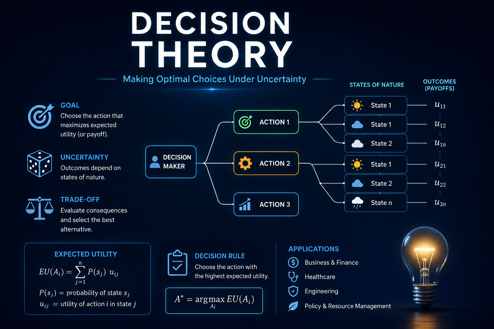
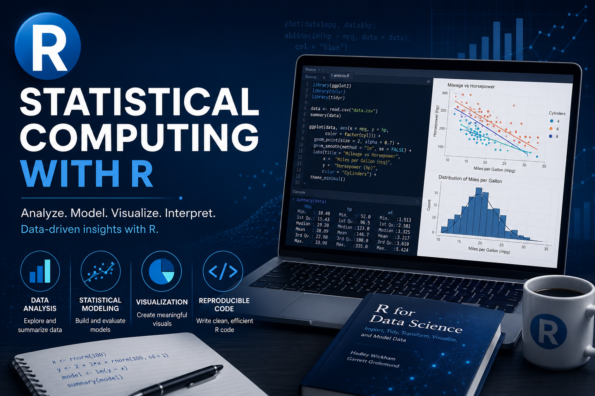

```{=html}
<section class="wrap page-head">
<p class="overline">Teaching</p>
<h1>Courses assisted</h1>
<p class="lead">I serve as a Volunteer Teaching Assistant in the Department of Statistics and Actuarial Science, University of Ghana, facilitating tutorials, assisting with practical classes, grading assignments and examinations, and supporting undergraduate students.</p>
</section>
<div class="wrap cv-layout">
<nav class="cv-toc" aria-label="Page sections"><a href="#first">First Semester, 2025/2026</a><a href="#second">Second Semester, 2025/2026</a></nav>
<div class="cv-main">
<section class="cv-section" id="first"><h2>First Semester, 2025/2026</h2>
<div class="entries">
<article class="course"><div><h4><a href="https://www.ug.edu.gh/statistics/academics/undergraduate-courses" target="_blank" rel="noopener">STAT 333: Statistical Inference I</a></h4><p class="meta">Volunteer Teaching Assistant, Department of Statistics and Actuarial Science</p><p>Facilitated tutorials, assisted with grading, and supported students in estimation, likelihood methods, confidence intervals, and statistical inference.</p></div></article>
<article class="course"><div><h4><a href="https://www.ug.edu.gh/statistics/academics/undergraduate-courses" target="_blank" rel="noopener">STAT 445: Advanced Regression Analysis</a></h4><p class="meta">Volunteer Teaching Assistant, Department of Statistics and Actuarial Science</p><p>Assisted students with multiple linear regression, diagnostics, model building, variable selection, interpretation of statistical models, and practical data analysis.</p></div></article>
<article class="course"><div><h4><a href="https://pharmacy.ug.edu.gh/academics/programmes" target="_blank" rel="noopener">PHMD 457: Biostatistics and Research Methods for Pharmacy</a></h4><p class="meta">Volunteer Teaching Assistant, Department of Pharmacy Practice and Clinical Pharmacy</p><p>Supported tutorials and practical sessions on statistical methods for health research, study design, hypothesis testing, data analysis, and interpretation of pharmaceutical research findings.</p></div></article>
</div>
</section>
<section class="cv-section" id="second"><h2>Second Semester, 2025/2026</h2>
<div class="entries">
<article class="course"><div><h4><a href="https://www.ug.edu.gh/statistics/academics/undergraduate-courses" target="_blank" rel="noopener">STAT 334: Statistical Inference II</a></h4><p class="meta">Volunteer Teaching Assistant, Department of Statistics and Actuarial Science</p><p>Assisted students in advanced statistical inference, parametric and nonparametric hypothesis testing, and simple linear regression.</p></div></article>
<article class="course"><div><h4><a href="https://www.ug.edu.gh/statistics/academics/undergraduate-courses" target="_blank" rel="noopener">STAT 338: Decision Theory</a></h4><p class="meta">Volunteer Teaching Assistant, Department of Statistics and Actuarial Science</p><p>Facilitated tutorials on Bayesian decision theory, loss and risk functions, admissibility, minimax procedures, and statistical decision-making.</p></div></article>
<article class="course"><div><h4><a href="https://www.ug.edu.gh/statistics/academics/undergraduate-courses" target="_blank" rel="noopener">STAT 464: Statistical Computing with R</a></h4><p class="meta">Volunteer Teaching Assistant, Department of Statistics and Actuarial Science</p><p>Guided students in statistical programming with R, including data manipulation, visualization, simulation, statistical modelling, and reproducible research.</p></div></article>
</div>
</section>
</div>
</div>
```
